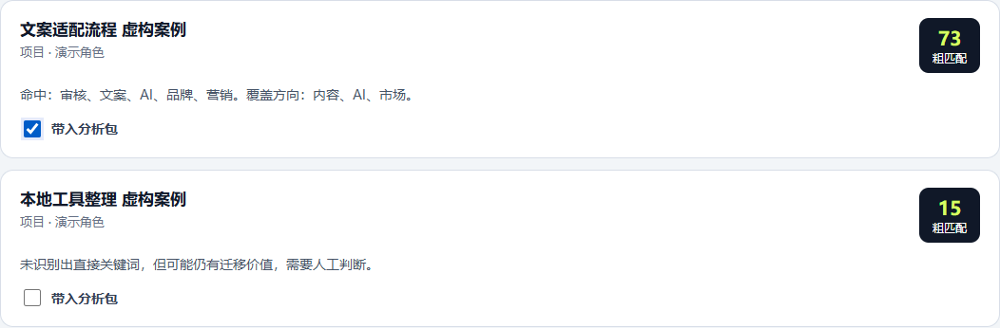

# 求职投递 Skill＋工作台

将求职材料整理成有证据的经历库，再围绕目标 JD 选材、确认和记录。

**当前版本：本地网页原型＋独立工作流 Skill。** 网页负责资料管理和分析包，AI 分析在外部工具中按 Skill 执行。

[打开网页 Demo](https://kafuka046-art.github.io/job-application-workbench/) · [查看操作说明](docs/DEMO.md) · [查看 Skill](skill/campus-application-workflow/SKILL.md) · [四个作品概览](https://github.com/kafuka046-art/writing-coach/blob/main/docs/PORTFOLIO.md)



## 为什么做

反复投递容易遇到三个问题：经历素材分散、为不同 JD 改写时扩大事实、忘记实际提交了哪个版本。本项目将经历事实、选材确认与投递记录分开保存，并把完整投递方法封装为 Skill。

## 已有功能

| 部分 | 当前功能 |
| --- | --- |
| 网页经历库 | 维护角色、动作、结果、证据与真实性边界 |
| JD 匹配 | 提取常见关键词，粗匹配经历，由使用者勾选材料 |
| 分析包 | 汇总候选人资料、JD、已选经历及规则，复制给外部 AI |
| 投递记录 | 人工登记岗位、状态及使用材料 |
| 本地数据 | 使用 localStorage 保存；支持 JSON 导入、导出 |
| Skill | 指导有对应工具能力的 AI 核查招聘规则、比较岗位、确认选材、制作材料与归档 |

网页未接 AI API，也不自动查岗位、生成最终简历或提交申请。关键词分数表示文本粗匹配，不是能力评分或录用概率。Skill 能否执行联网、文档制作和网页操作，取决于使用环境的工具与授权。

## 本人贡献

本人设计个人投递流程、事实边界与确认节点，借助 AI 开发本地网页，并封装求职工作流 Skill、模板及使用演示。

这是个人流程工具化项目；目前没有外部用户采用或录用转化数据。

## 怎么使用

1. 下载仓库，在浏览器打开 `index.html`。
2. 录入经历，粘贴公司、岗位和完整 JD，人工勾选材料。
3. 在“分析包”完成检查并复制文本。
4. 在能读取 Skill 的 AI 环境中，提供 `skill/campus-application-workflow/SKILL.md` 及分析包；先看分析与选材方案，确认后制作材料。
5. 投递完成后回到网页登记状态；定期导出备份。

用虚构资料体验时，先阅读 [Demo](docs/DEMO.md)，通过“导入数据”选择 `examples/demo-data.json`。导入会替换当前工具中的数据，已有资料应先导出。

## 网页与 Skill 的关系

```text
网页：经历库 + JD + 人工选材
                ↓ 复制分析包
外部 AI：按 Skill 核查、分析、等待确认、制作材料
                ↓ 人工登记
网页：投递状态 + 备份
```

网页已承载部分整理与选材步骤。直接在网页运行 Skill、保存 AI 结果及生成文件属于后续开发。

## 数据说明

网页资料存在当前浏览器中。复制给外部 AI 后，应按该工具的数据处理规则使用。代码中不附带本人资料、投递记录、真实 JSON 备份或公司内部材料。

## 目录

```text
index.html / app.css / app.js       本地网页
skill/campus-application-workflow/  Skill 及参考模板
examples/demo-data.json            虚构演示数据
docs/DEMO.md                       操作步骤与验收方式
```
